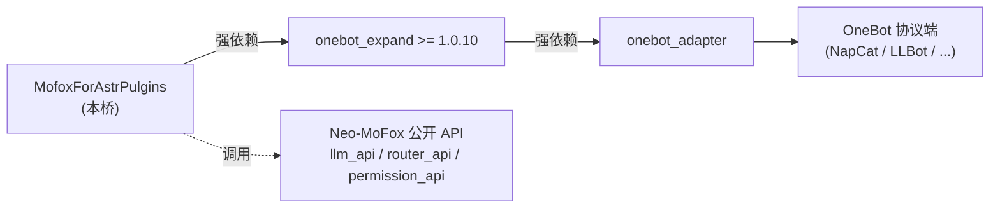
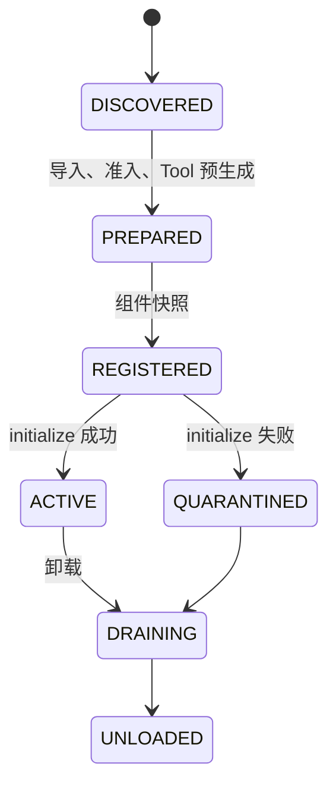

# AstrBot 插件兼容桥

`MofoxForAstrPulgins` 在 Neo-MoFox 中运行来自**可信来源**的 AstrBot `Star`
插件。它是面向 `qq` / OneBot / Aiocqhttp 的受限兼容运行时，不是 import shim：
已映射能力走 Neo-MoFox 的公开组件、Service、Router 与 TaskManager；没有无损映射
的能力会在准入期或调用期明确失败，不会降级为文本、空对象或伪成功。

> 本桥只加载可信插件，外部代码与宿主同进程执行，**不构成沙箱**。

---

## 前置依赖

本桥强依赖 [`onebot_expand`](../onebot_expand) 提供的 OneBot 发送链路与账号资料查询能力。
没有 `onebot_expand` 或其关键 Service 未注册时，桥会在准入阶段直接拒绝激活，不会静默降级。

### 依赖链



### 在 manifest 中的声明

`manifest.json` 同时声明了**插件级**与**组件级**两层依赖，二者会被主程序
`PluginLoader`、`PluginManager` 与 WebUI 插件管理页一致识别：

| 层级 | 字段 | 值 | 作用 |
| --- | --- | --- | --- |
| 插件级 | `dependencies.plugins` | `["onebot_expand>=1.0.10"]` | 加载前拓扑排序与版本校验，缺失/版本不满足则整桥不加载 |
| 插件级 | `dependencies.components` | `["onebot_expand:service:message_service", "onebot_expand:service:account_service"]` | WebUI 插件详情展示前置组件 |
| 组件级 | `include[event_handler].dependencies` | 同上 | 桥事件处理器 `AstrPluginBridge.dependencies` 显式声明，注册表可校验 |

> 版本约束语法遵循 PEP 440（`>=`、`==`、`~=>` 等），由
> `src/core/components/loader.py:_split_plugin_dependency_ref` 解析，
> `packaging.specifiers.SpecifierSet` 校验。

### 需要自行安装的 Python 包

无。本桥不引入额外 Python 依赖；运行所需的 AstrBot SDK 由桥自身在进程内构造的
`sys.modules` shim 提供，外部 AstrBot 插件按其原生 `from astrbot.api import ...` 导入即可。

---

## 快速开始

### 1. 确认前置条件

- Neo-MoFox 主程序已启动，且 `onebot_expand >= 1.0.10` 与 `onebot_adapter` 已加载（WebUI → 插件管理页可见二者均为已加载）；
- OneBot 协议端（NapCat / LLBot 等）已连接，`qq` 平台适配器处于 active 状态；
- 桥本身在插件管理页显示为已加载（`MofoxForAstrPulgins v0.1.2`）。

### 2. 放入 AstrBot 插件

将待加载的 AstrBot `Star` 插件目录放入本桥的 `plugins/` 子目录，每个子目录必须包含 `main.py`：

```text
plugins/MofoxForAstrPulgins/plugins/
└── astrbot_plugin_box/      # 示例：已内置
    ├── main.py              # 入口，必须存在
    ├── _conf_schema.json    # 可选，只读取默认值
    └── metadata.yaml
```

也可在 WebUI → 插件配置 → `MofoxForAstrPulgins` 中修改：

| 配置项 | 作用 |
| --- | --- |
| `plugin.enabled` | 是否启用兼容桥，关闭后整桥不激活 |
| `plugin.plugins_root` | 扫描根目录，每个子目录作为一个单元加载；留空则默认为桥同级 `plugins/` |
| `plugin.plugin_path` | 只加载指定单个插件目录；留空则批量扫描 `plugins_root` |
| `plugin.provider_task_map` | AstrBot `chat_provider_id` 到 Neo-MoFox 模型任务的显式映射，未知 ID 会失败而非回退默认 |
| `plugin.unload_timeout_seconds` | 卸载时 drain 与 `terminate()` 的最大等待秒数 |

### 3. 配置模型任务映射（按需）

若 AstrBot 插件调用 `Context.llm_generate()` 并传入 `provider_id`，必须在 `provider_task_map` 中显式映射到 Neo-MoFox 的模型任务名，否则会失败：

```json
{
  "plugin": {
    "provider_task_map": {
      "default": "utils_small",
      "openai_chat": "main_chat"
    }
  }
}
```

### 4. 重载桥使配置生效

在 WebUI → 插件管理页找到 `MofoxForAstrPulgins`，点击「重载」。重载会重新扫描 `plugins/`、执行各单元 `initialize()`，失败单元会被隔离但不影响其他单元。

### 5. 验证

- WebUI → 插件管理 → `MofoxForAstrPulgins` 详情页，`组件` 列表应包含 `event_handler:astr_plugin_bridge`、`router:astr_compat_router` 及桥为外部插件生成的 `tool:astr__{slug}__{name}`；
- 在 QQ 群/私聊中触发外部插件注册的命令，观察是否正常响应；
- 外部插件注册的 Web API 可通过 `http://127.0.0.1:8005/compat/astr/{slug}/{relative_route}` 访问。

### 故障排查

| 现象 | 排查方向 |
| --- | --- |
| 桥未加载 | 检查 `onebot_expand` 是否已加载且版本 ≥ 1.0.10；查看主程序日志 `plugin_loader` / `deps_installer` 段 |
| 外部单元被隔离 | 查看日志中 `astr_plugin_bridge` 的准入失败原因：缺少 `main.py`、`initialize()` 抛异常、provider 未映射等 |
| LLM 调用失败 | 确认 `provider_task_map` 覆盖了插件使用的 `provider_id`，且对应模型任务在 Neo-MoFox 中可用 |
| 命令无响应 | 确认 OneBot 协议端已连接、消息平台为 `qq`、外部插件的 `@filter` 平台/权限条件匹配 |

---

## 加载位置和前置条件

默认扫描本桥目录下的 `plugins/`，其中每个外部单元至少包含 `main.py`：

```text
MofoxForAstrPulgins/
├── plugin.py
├── config.py
└── plugins/
    └── astrbot_plugin_example/
        ├── main.py
        └── _conf_schema.json  # 可选，只读取默认值
```

- `plugin.plugins_root` 可改为一个包含多个外部目录的扫描根目录；
- `plugin.plugin_path` 可指定单个外部目录；
- 桥强依赖 `onebot_expand>=1.0.10`，且其 `message_service`、`account_service`
  必须已注册；
- 外部代码与宿主同进程执行，不构成沙箱，只应加载可信插件。

## 已映射的运行语义

| AstrBot 能力 | Neo-MoFox 行为 |
| --- | --- |
| `Star` / `Context` | 每个外部目录形成独立单元；`initialize()` 在注册后执行，`terminate()` 在卸载时执行。 |
| `@filter.command`、命令组、`regex`、消息类型、平台、权限和自定义过滤器 | 在桥事件处理器中严格匹配；仅支持可验证的 OneBot/Aiocqhttp 平台和 `ADMIN` / `MEMBER` 权限语义，未知过滤器不默认放行。 |
| `@filter.llm_tool`、`Context.add_llm_tools(FunctionTool)` | 在组件快照前生成命名空间化 `BaseTool`：`astr__{slug}__{name}`。运行期新增/删除宿主 Tool 被拒绝。 |
| `Context.llm_generate()` / provider 查询 | 必须由 `plugin.provider_task_map` 显式映射 `chat_provider_id` 到模型任务；未知 provider 不回退到默认任务。响应保留 `reasoning_content`、`reasoning_parts` 和工具调用。 |
| `event.plain_result()`、`chain_result()`、`event.send()`、`Context.send_message()` | 严格转换为完整 OneBot 段后，经公开 `onebot_expand` Service 发送；任一不可映射段都会失败。 |
| `AiocqhttpMessageEvent.bot` | 白名单门面：资料查询、群/私聊发送、撤回、读取消息和转发消息。原始 OneBot 成功/失败 wrapper 保持可见。 |
| OneBot 入站消息 | 保留宿主纯文本、协议原始 `message` 段、`self_id` 与原始事件快照；`Plain`、`At`、图片、语音、回复、视频等可恢复为组件链。 |
| 组件类身份 | 单元会捕获当前与多份旧 SDK 的已验证组件类，入站对象对两端都满足 `isinstance()`；未登记类型仍不会被按名称宽松接受。 |
| `Context.register_task(coro)` | 通过 TaskManager 受管创建，按单元跟踪并在卸载时取消、等待。 |
| `Context.register_web_api()` | 真实挂载到静态 Router 的 `/compat/astr/{slug}/{relative_route}`，支持受限 HTTP 方法；卸载后不可到达外部处理器。 |
| 已映射 Hook | `on_llm_request`、`on_llm_response`、`after_message_sent`、`on_astrbot_loaded`；只回写 EventBus 现有字段。 |

消息链仅接受可严格映射的 `Plain`、`At`、`Reply`、`Image`、`Record`、`Video`
和 `File`。`Face`、转发节点和任意未知自定义组件不会被悄悄改写成文本。

## 生命周期和隔离



单元激活失败只会隔离自身。卸载会先拒绝新事件、工具、HTTP 与任务调用，再取消
受管任务、等待活动调用、执行 `terminate()`、卸载 Router 并清理私有模块前缀。

## 明确不支持

- 任意非 QQ / OneBot 平台适配器、任意平台实例、`register_platform()`；
- 自定义 Provider 注册、未显式映射的 provider、对宿主模型注册表的 monkey patch；
- 未映射 Hook、conversation/persona/history/knowledge/cron/Dashboard 等 AstrBot 管理器语义；
- 任意 `event.bot.call_action()`、非白名单 OneBot API、服务缺失、连接断开或 OneBot 失败响应；
- 任意绝对/通配 Web 路径、未允许 HTTP 方法，及运行期改变宿主组件快照；
- 将外部 `_conf_schema.json` 写回宿主 WebUI 配置。当前只读取 schema 默认值。

## 验证范围与生产边界

已验证的自动化链路包括真实 `PluginManager`、`EventBus`、`RouterManager` / FastAPI、
`onebot_expand` Service、`AdapterManager`、`OneBotAdapter`，以及受控本地 WebSocket
协议端。测试通过真实 WebSocket 入站 JSON 驱动 Adapter，并验证查询、图片段发送、原始
响应 wrapper 和失败传播。

这证明桥与公开 Neo-MoFox OneBot 传输链路的集成语义；**不等同于**真实 QQ、NapCat 或
SnowLuma 的生产部署验收。生产协议端仍需在目标环境中单独验证。
