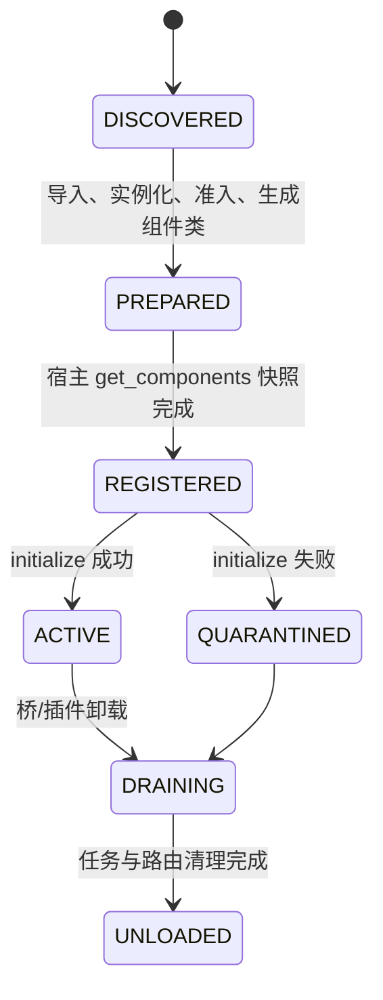

# AstrBot 兼容桥可验证设计

> **状态：受限兼容子集已实施；focused、宿主集成和受控本地 Adapter 传输验收通过。**  
> **目标版本：AstrBot Core 4.26.8、Neo-MoFox 1.3.0-alpha.0、`onebot_expand` ≥ 1.0.10。**  
> 本文定义 `MofoxForAstrPulgins` 的可支持子集、拒绝边界和验收证据；任何未被列为“支持”的路径均不得以空对象、空列表、`True` 或日志掩盖失败。

## 实施状态（2026-08）

已实施并有 focused 测试证据：OneBot 嵌套消息段与完整 Service 响应、构造期 Tool 预备及组件快照
缓存、Provider 显式映射、LLM response 的 `reasoning_content` / `reasoning_parts` 映射、Before/After
LLM Hook 对既有 EventBus 字段的安全回写、Router 卸载判断、notice 派发、受管任务 drain，以及 bundled
Box 的嵌套配置与 OneBot `data` 包装处理。外部单元会捕获当前 SDK 和多份旧 SDK 的实际消息组件类；
入站对象在可安全合并时对这些类均保持 `isinstance()` 语义，出站只接受显式登记且段契约匹配的旧类。

真实 `PluginManager` / `EventBus` 路径已验证 Box 命令、资料查询、本地图像生成和完整 OneBot 图像段发送；
真实 `RouterManager` / FastAPI 路径已验证挂载、请求分派与卸载。真实 `onebot_expand` Service、
`AdapterManager`、`OneBotAdapter` 与受控本地 WebSocket 协议端的端到端验收已完成：测试由协议端发送真实
入站 JSON、由 Adapter 建立消息事件，并验证资料查询、图片段发送、原始 OneBot 响应和失败传播。

受控协议端验证的是公开 Neo-MoFox 传输链路，**不等同于**真实 QQ、NapCat 或 SnowLuma 的生产部署验收；
后者仍须在目标环境单独验证。本文未在本状态段明确列为已实施的能力仍属于设计约束或拒绝边界，不应被解释为完成承诺。

## 1. 决策摘要

桥不是 AstrBot 运行时的替代品，而是一个**OneBot/Aiocqhttp 定向兼容层**：

- 仅接纳可完整映射到 Neo-MoFox 公开能力的 AstrBot `Star` 插件；
- 将 `onebot_expand` 作为强插件依赖，所有 OneBot 私有 API 经过其 Service 层，而不是访问 `onebot_adapter` 私有对象；
- 动态 LLM 工具必须在宿主执行 `get_components()` 快照前生成；
- 无真实宿主映射的能力在准入期或首次调用时抛出可识别错误，绝不伪成功；
- 兼容插件仅应来自可信来源。准入扫描检查兼容性，不构成 Python 代码沙箱。

桥的目标是让命令、正则、消息过滤器、可映射的 LLM 工具、OneBot 查询/发送和受限 Web API 真正工作；不是承诺全量 AstrBot API 兼容。

## 2. 已核验的宿主事实

| 事实 | 对设计的约束 |
| --- | --- |
| 插件加载顺序为：实例化 → `_register_components()`（`get_components()` 快照）→ `on_plugin_loaded()` → 注册事件处理器 | 不能在 `on_plugin_loaded()` 才创建希望被宿主发现的 `BaseTool`。 |
| 组件注册表可按签名注册/注销，但工具使用方只应依赖加载期已注册组件 | 外部工具在预备阶段生成；晚注册工具拒绝，不依赖偶然的注册表可见性。 |
| EventBus 的返回值必须是 `(EventDecision, params)`，且 `params` 键集合必须与输入完全相同 | 钩子适配器只能改已有字段，不能追加桥私有键。 |
| `TaskManager` 可创建和取消任务，但不会在插件卸载时自动 drain | 桥必须逐单元跟踪任务、拒绝卸载后的新任务并显式取消/等待。 |
| Router 可在运行时挂载/卸载；插件卸载不会替桥自动卸载其 Router | 桥在自己的卸载钩子中显式卸载桥 Router。 |
| `onebot_expand` 通过公开 `service_api.get_service()` 暴露 Service，实例非单例 | OneBot 门面按调用解析 Service，不缓存可变 Service 实例。 |
| `onebot_adapter` 出站段支持 `text`、`at`、`image`、`emoji`、`voice`、`voiceurl`、`music`、`videourl`、`file`、`reply`、`seglist`；`face` 没有可靠出站实现 | 消息链转换必须逐段验证，不得把不支持段静默丢弃或转成文本占位。 |
| 普通 OneBot message 与 notice 都可保留深拷贝的协议原始事件；普通 message 的 `self_id` 已写入公开 `Message.extra` | Astr 事件可同时保留宿主 plain text、原始 `message` 段和 `self_id`；桥不得修改原始输入对象。 |

## 3. 范围与术语

- **桥插件**：`MofoxForAstrPulgins` 本身。
- **外部单元（unit）**：一个被桥加载的 `main.py` 中的唯一 `Star` 子类实例。
- **预备阶段**：桥构造期间完成的同步发现、导入、实例化、准入和组件类生成阶段。
- **激活阶段**：`on_plugin_loaded()` 期间执行的异步 `initialize()` 和桥资源启动阶段。
- **桥配置的插件 slug**：由外部目录名和稳定短哈希生成，只用于隔离配置、任务和宿主组件名。
- **OneBot profile**：事件来自已运行的 `onebot_adapter`、平台为 `qq`，且可通过 `onebot_expand` Service 发送/查询的路径。

不在范围内：任意 AstrBot 平台适配器、任意自定义 Provider 注册、AstrBot Dashboard 原始路由命名空间、未映射的管理器、以及对不可信 Python 插件的隔离执行。

## 4. 不可违反的总契约

1. **无伪成功。** 无宿主实现的功能必须在准入时拒绝，或在调用点抛出 `UnsupportedAstrCapabilityError`；不得返回空代理、空列表或固定 `True`。
2. **一次确定的组件集合。** 会被 Neo-MoFox 使用的外部 LLM 工具在预备阶段生成并包含在 `get_components()` 中；激活后新增的工具抛出 `LateComponentRegistrationError`。
3. **命名不碰撞。** 对宿主暴露的工具名为 `astr__{slug}__{external_name}`；原始 Astr 名称仅保留在单元内的反向映射中。
4. **平台不匹配即失败。** `AiocqhttpMessageEvent`、`event.bot` 和 OneBot 发送能力只在 OneBot profile 下可用；不能因为当前消息不是 QQ 而假装成功。
5. **调用以真实响应为准。** `onebot_expand` 返回的 `status`、`retcode`、`data`、错误信息原样保留；连接未建立或 API 失败抛出桥错误，不构造成功响应。
6. **卸载先隔离，后清理。** 进入 `DRAINING` 的单元不可再接收事件、工具调用、HTTP 请求或新后台任务。
7. **不访问私有宿主状态。** 不写 `ConfigManager._configs`，不 monkey-patch `ModelClientRegistry` 的 slots，不直接使用适配器 WebSocket，也不调用裸 `asyncio.create_task()`。

## 5. 准入契约

### 5.1 桥清单与依赖

桥的 `manifest.json` 必须声明：

```json
{
  "dependencies": {
    "plugins": ["onebot_expand>=1.0.10"],
    "components": []
  }
}
```

由宿主插件加载器完成拓扑排序和版本校验。若 `onebot_expand` 缺失或版本不满足，桥不进入实例化阶段；这不是可降级能力。

预备阶段还必须确认以下 Service 类均已存在：

- `onebot_expand:service:message_service`
- `onebot_expand:service:account_service`

缺任一个时，整个桥拒绝启动，并列出缺失签名。

### 5.2 外部插件目录与导入

一个候选目录必须同时满足：

1. 目录中存在 `main.py`；
2. 导入后仅发现一个非基类 `Star` 子类；
3. 该类构造函数仅使用兼容层已支持的 `Context` 与可选配置字典；
4. 其声明的过滤器、工具、钩子和 Web API 全部通过本节准入；
5. 同一加载批次内不存在 slug、宿主工具名或受限 Web 路由冲突。

导入模块使用桥私有模块前缀，例如 `_mofox_astr_{slug}`。失败时删除该前缀模块和预备期登记，不保留半加载单元。

### 5.3 支持的声明

| AstrBot 声明 | 准入条件 | 宿主映射 |
| --- | --- | --- |
| `@filter.command`、`command_group` | 参数能由桥命令解析器表达 | 桥 `BaseEventHandler` 内部派发。 |
| `@filter.regex` | Python 正则可编译 | 桥内部派发。 |
| `@filter.event_message_type` | 仅群聊、私聊、通知、其他的明确值 | 以 `Message.chat_type` 判定。 |
| `@filter.platform_adapter_type` | 值为 OneBot/Aiocqhttp 兼容类型 | 仅 OneBot profile 匹配；非匹配为 `False`。 |
| `@filter.permission_type` | 值在桥的权限映射表内 | 宿主权限等级与 `sender_role` 的只读映射。 |
| `@filter.custom_filter` | 过滤器可在只读事件上同步/异步返回布尔值 | 失败按“不匹配”处理并记录错误。 |
| `@filter.llm_tool` | 签名可生成 JSON Schema，名称非空 | 预备期生成桥拥有的 `BaseTool`。 |
| `Context.add_llm_tools(FunctionTool)` | 调用发生在 `Star.__init__` / 预备阶段 | 预备期生成桥拥有的 `BaseTool`。 |
| `initialize()`、`terminate()` | 均为可等待调用或同步无返回调用 | 分别在激活和卸载阶段执行。 |
| `on_astrbot_loaded`、`on_llm_request`、`on_llm_response`、`after_message_sent` | 不请求未映射字段或未映射修改 | 见第 8 节。 |
| `Context.register_web_api` | 路径为相对路径、方法在 allowlist 内、无冲突 | 桥静态 Router 下的受限路由。 |

### 5.4 硬性拒绝的声明

下列声明或行为必须让**该外部单元**被拒绝；桥中其他已通过准入的单元仍可运行：

| 能力 | 拒绝原因 |
| --- | --- |
| `register_provider()`、自定义 Provider、未配置的 `provider_id` | 宿主没有公开的通用 Provider 注册组件；伪造 Provider 会改变模型选择语义。 |
| `get_platform_inst()`、`register_platform()` 或要求任意平台实例 | 桥只覆盖已有 OneBot profile，不创建 AstrBot 平台适配器。 |
| `context.register_task()` 在激活后注册 LLM 工具或 Web 组件 | 已越过宿主组件快照，不能保证被工具/路由管理器发现。 |
| `on_agent_begin`、`on_agent_done`、`on_waiting_llm_request`、`on_using_llm_tool`、`on_llm_tool_respond`、`on_decorating_result`、`on_platform_loaded`、`on_plugin_error` | 宿主无等价生命周期事件或无法保留原始参数/顺序。 |
| 需要 AstrBot conversation/persona/history/knowledge/cron 管理器真实行为 | 宿主没有同名可替换管理器；返回 `_NullCallable` 属于伪成功。 |
| 全局 Dashboard 原始路径挂载、通配路径、任意 HTTP 方法 | 只能使用桥隔离的 Router 命名空间。 |
| 不支持的消息组件：`Face`、`Node`、合并转发节点、未知自定义组件 | 当前 OneBot 出站链路没有无损映射。 |
| 在运行时添加/删除会暴露给宿主的工具 | 违反加载期组件快照契约。 |

拒绝报告必须包含：`slug`、源文件、声明类型、声明名、稳定错误码和可读原因。

## 6. 生命周期与组件注册

### 6.1 两阶段状态机



### 6.2 预备阶段

桥构造函数接收已加载的 `AstrCompatConfig` 后同步执行：

1. 解析候选目录和每个单元 slug；
2. 导入 `main.py`、创建 `Context` 和 `Star` 实例；
3. 读取 `_conf_schema.json` 的默认值，但不把未知结构写入宿主私有配置缓存；
4. 捕获私有模块前缀中实际持有的 `Plain`、`At`、`Image`、`Record`、`Reply`、`Video`、`File` 类；
  只登记其 `type` 契约可验证的类，并在安全可多继承时构造单元局部的类身份合并类型；
5. 扫描过滤器、`FunctionTool`、LLM 工具、钩子及 Web API 声明；
6. 执行准入；
7. 生成 `BaseTool` 子类和一个桥静态 `BaseRouter` 子类；
8. 让 `get_components()` 返回桥事件处理器、桥 Router 和全部已准入工具类。

预备阶段**不得**调用外部 `initialize()`、发消息、启动后台循环或调用外部网络 API。

### 6.3 激活与故障隔离

`on_plugin_loaded()` 对每个 `REGISTERED` 单元执行 `initialize()`。成功后置为 `ACTIVE`；失败后置为 `QUARANTINED`，并保存结构化失败原因。

隔离单元的工具、事件和 HTTP 请求统一返回/抛出 `UnitUnavailableError`，而不是继续调用残缺实例。桥本身仍完成加载，使其他独立单元可用。

### 6.4 卸载顺序

在桥的 `on_plugin_unloaded()` 中严格执行：

1. 所有单元切为 `DRAINING`，并从事件、工具和 HTTP 路由查找表摘除；
2. 取消其 `TaskManager` 任务；
3. 在配置的有限期限内等待正在执行的事件、工具、HTTP 和 LLM 钩子归零；
4. 对仍未结束的调用取消并记录 `forced_cancel`；
5. 调用每个仍有实例单元的 `terminate()`，单元级超时独立计；
6. 通过 `RouterManager.unmount_router()` 卸载桥 Router；
7. 清理桥私有模块前缀、OneBot 门面引用、工具反向映射和配置轮询；
8. 最后让宿主继续注销事件处理器和组件。

任何清理失败都记录，但不得重新开放 `DRAINING` 单元。

## 7. 真实能力映射

### 7.1 OneBot `event.bot` 门面

`AiocqhttpMessageEvent.bot` 不再是无条件失败的占位对象。它是只暴露以下方法的 `OneBotBotFacade`：

| AstrBot 门面方法 | Service 签名 / 方法 | 结果 |
| --- | --- | --- |
| `get_stranger_info(user_id, no_cache=False)` | `account_service.get_stranger_info()` | 原样 OneBot 响应字典。 |
| `get_group_member_info(group_id, user_id, no_cache=False)` | `account_service.get_group_member_info()` | 原样 OneBot 响应字典。 |
| `send_group_msg(group_id, message, auto_escape=False)` | `message_service.send_group_msg()` | 原样 OneBot 响应字典。 |
| `send_private_msg(user_id, message, auto_escape=False)` | `message_service.send_private_msg()` | 原样 OneBot 响应字典。 |
| `delete_msg(message_id)` | `message_service.delete_msg()` | 原样 OneBot 响应字典。 |
| `get_msg(message_id)` | `message_service.get_msg()` | 原样 OneBot 响应字典。 |
| `get_forward_msg(message_id)` | `message_service.get_forward_msg()` | 原样 OneBot 响应字典。 |

门面按调用执行 `get_service()`，验证参数类型和 OneBot profile。未声明属性、非 QQ 事件、Service 缺失、连接断开和非 `ok` OneBot 响应均不得转换成成功值。

### 7.2 入站消息到 Astr 事件

桥从 `Message` 构建独立的事件快照，至少包含：

- 会话、消息、发送者、群组、平台元数据；
- 纯文本、`reply_to`、`at_users`、媒体和已知未知段；
- `is_admin` 的宿主权限解析结果；
- OneBot profile 下可用的 `OneBotBotFacade`。

当 `Message.raw_data` 含协议快照时，事件的 `raw_message` 保留该完整快照，`message` 段按原顺序转换；
原始段没有文本而宿主 plain text 非空时，在首位补一个 `Plain`，二者均不丢失。无法从公开 `Message` 字段
取得的协议字段仍必须标记为“不可用”，不可构造看似真实的原始值。

若外部单元因隔离导入持有旧 SDK 组件类，桥仅对预备期从该单元私有模块中捕获、并通过严格 `type` 契约校验
的类进行登记。对于同一类目的多份旧类，入站组件会同时继承当前 canonical 类和全部可安全合并的旧类；
无法安全合并的组合在准入期拒绝。桥绝不按模块名或类名字符串接受未登记对象。

### 7.3 Astr 消息组件到 OneBot 段

| Astr 组件 | OneBot 段 | 约束 |
| --- | --- | --- |
| `Plain` | `text` | 使用适配器接受的文本段数据结构。 |
| `At` | `at` | 目标必须是可解析的用户 ID。 |
| `Reply` | `reply` | 仅一个引用段；置于首段。 |
| `Image` | `image` | URL、文件或 Base64 必须可被适配器接受；补齐 `Image.fromBytes()`。 |
| `Record` | `voice` / `voiceurl` | 根据来源类型选择；无来源拒绝。 |
| `Video` | `videourl` | 仅 URL 或已支持的本地来源。 |
| `File` | `file` | 仅适配器可访问路径。 |
| `Face`、`Node`、未知组件 | 无 | 抛出 `UnsupportedMessageSegmentError`。 |

对于 `event.send()`、`MessageEventResult` 和 `Context.send_message()`，桥先把整条链转换为与对应 `onebot_expand` Service 签名一致的 OneBot 段列表；只有全部段可映射时才调用 `MessageService`。不得只发送其中的文本部分。

### 7.4 过滤器与权限

- `command`/`command_group`：保留前缀、别名和剩余参数；类型转换失败为该处理器不匹配或明确参数错误，不能调用错误签名。
- `regex`：使用预编译模式，正则异常在准入时拒绝。
- `event_message_type`：群聊、私聊、通知、其他严格映射；未知值不匹配。
- `platform_adapter_type`：仅 `aiocqhttp` / 已配置 OneBot 别名匹配；不再无条件放行。
- `permission_type`：仅桥的显式枚举映射表中可验证的值可用；未知值在准入期拒绝。权限判定使用宿主权限 API 和 `sender_role`，不会把所有用户当管理员。
- `custom_filter`：接收只读事件快照；异常记日志并视作不匹配。

### 7.5 LLM 调用、工具与钩子

`Context.llm_generate()` 仅接受桥配置中显式允许的 `chat_provider_id` 到 Neo-MoFox 模型任务映射。未知 ID 抛出 `UnknownProviderIdError`；不得像当前实现那样忽略 ID 并固定使用 `utils_small`。

请求映射必须保留：系统提示、上下文角色、文本、支持的图片/音频引用、工具 schema、流式标志和模型任务。不能表达的参数拒绝，不悄悄丢弃。

`tool_loop_agent()` 只有在下列条件同时满足时才可启用：所有工具都来自该单元已准入的桥工具映射、每一步结果可转为宿主工具调用/响应、并且步骤数不超过配置上限。否则抛出 `AgentLoopUnsupportedError`；不得把它伪装成一次普通 `llm_generate()`。

支持的钩子映射：

| Astr 钩子 | 宿主事件 | 可回写字段 |
| --- | --- | --- |
| `on_llm_request` | `BEFORE_LLM_REQUEST` | `payloads`、`tools`、`stream`。 |
| `on_llm_response` | `AFTER_LLM_REQUEST` | `message`、`reasoning_content`、`reasoning_parts`、`tool_calls`。 |
| `after_message_sent` | `AFTER_MESSAGE_SENT` | 只读。 |
| `on_astrbot_loaded` | `ON_ALL_PLUGIN_LOADED` | 只读。 |

钩子适配器从真实事件参数构建请求/响应对象；不能用空提示词、空上下文或错误类型的 `Message` 代替 LLM 响应。回写时保持 EventBus 原始键集合不变。

### 7.6 Web API

桥预注册一个静态 `AstrCompatRouter`。`Context.register_web_api()` 只允许注册在：

`/compat/astr/{slug}/{relative_route}`

下。允许方法为 `GET`、`POST`、`PUT`、`DELETE`、`PATCH`，不允许通配、绝对宿主根路径或与同单元已有 `(method, route)` 冲突的路由。

静态 Router 在每个请求时查桥的单元路由表，因此外部单元可以在激活期间登记受限路由，无需晚注册宿主 Router 组件。卸载后返回 404/503，绝不调用已释放单元。

## 8. 配置、任务与并发

### 8.1 配置

外部 `_conf_schema.json` 可转换为 `SectionBase`，但结构化 WebUI 配置合并有一个前置条件：宿主必须提供**公开**的“替换插件配置类并重载”API。实现不得修改 `ConfigManager._configs`。

在该公开 API 尚未提供前：

- 桥仅使用 `AstrCompatConfig` 和外部 schema 的默认值；
- 不向用户声明外部配置已在 WebUI 保存；
- 插件调用需要持久化配置时抛出 `ConfigPersistenceUnsupportedError`。

公开 API 到位后，配置更新必须经历：TOML 校验 → 原子替换 → 单元配置快照更新 → 回调；任何单元拒绝新配置时不写入部分状态。

### 8.2 后台任务

`Context.register_task(coro)`：

1. 验证单元处于 `ACTIVE` 且参数为协程；
2. 用 `get_task_manager().create_task()` 创建任务，设置 `group_name="compat:astr:{slug}"`；
3. 保存 `TaskInfo.task_id`；
4. 卸载时取消全部保存的 ID 并等待有限时长。

不允许 `asyncio.ensure_future()`、`asyncio.create_task()` 或未跟踪的循环任务。

### 8.3 并发门

每个单元维护状态锁、活动调用计数和 `asyncio.Condition`：

- 事件、工具、HTTP、LLM 钩子进入前取得 lease；
- `DRAINING` / `UNLOADED` 状态拒绝 lease；
- 退出时递减计数并通知卸载流程；
- 不在持锁期间执行外部插件代码；
- 单元调用使用独立超时，超时后记录调用类型和单元 slug。

## 9. 验收测试与证据

实施必须新增独立单元测试，至少覆盖：

| 编号 | 场景 | 可观察断言 |
| --- | --- | --- |
| A01 | 缺少或版本不满足 `onebot_expand` | 桥未实例化，错误列出依赖。 |
| A02 | 工具在 `Star.__init__` 中声明 | `get_components()` 快照含 namespaced `BaseTool`，宿主可执行。 |
| A03 | `initialize()` 后才 `add_llm_tools()` | 抛出 `LateComponentRegistrationError`，注册表无伪工具。 |
| A04 | 同名外部工具 | 两个宿主工具名不同，均反向调用各自外部处理器。 |
| A05 | QQ 事件的 `event.bot.send_group_msg()` | mock `MessageService` 接到完整段数组并返回原始响应。 |
| A06 | 非 QQ 事件调用 `event.bot` | 抛出平台不支持错误，没有 API 调用。 |
| A07 | `Plain + At + Image + Reply`，以及同一单元的多个旧 SDK 组件类 | 段顺序、数据结构和首位 `reply` 完整保留；已登记的 canonical/旧类均通过 `isinstance()`，未知类仍拒绝。 |
| A08 | `Face` / `Node` | 明确失败，未发送残缺文本。 |
| A09 | `platform_adapter_type` / `permission_type` | 匹配与不匹配均按真实条件决定，不存在无条件放行。 |
| A10 | LLM 前后钩子 | 收到真实 payload/response，且回写后 EventBus 键集合不变。 |
| A11 | 未知 `provider_id` | 失败，不回退至默认任务。 |
| A12 | 路由注册与卸载 | 路由限制在桥前缀，卸载后不能再到达外部处理器。 |
| A13 | 长运行任务与卸载 | 新调用被拒绝；任务取消、`terminate()` 和 Router 清理都有证据。 |
| A14 | `initialize()` 失败 | 单元隔离，其他单元和桥事件处理器仍正常。 |

最低集成证据已完成：启动包含 `onebot_adapter`、`onebot_expand` 和桥的测试宿主，由受控本地 WebSocket
协议端发送一条 QQ 群入站 JSON，验证命令回复、图片回复、OneBot 查询响应、原始事件/`self_id` 保留、失败
响应传播和卸载后无残留 Router/任务。该证据不替代真实 QQ/NapCat/SnowLuma 生产协议端验证。

## 10. 实施门槛与顺序

1. 先修订清单依赖和预备期单元模型；
2. 先实现并测试 OneBot Service 门面和消息链无损转换；
3. 实现加载期动态工具注册、命名空间和单元状态门；
4. 实现事件过滤、LLM 钩子和严格 Provider ID 映射；
5. 实现 Router、任务跟踪和卸载 drain；
6. 在宿主公开配置替换 API 设计/通过后，再实施结构化配置 WebUI；
7. 最后删除现有空代理、`ensure_future`、晚注册工具和“记录但不挂载”的伪实现。

只有第 9 节全部通过后，本文定义的支持项才可在 README 中宣称可用。