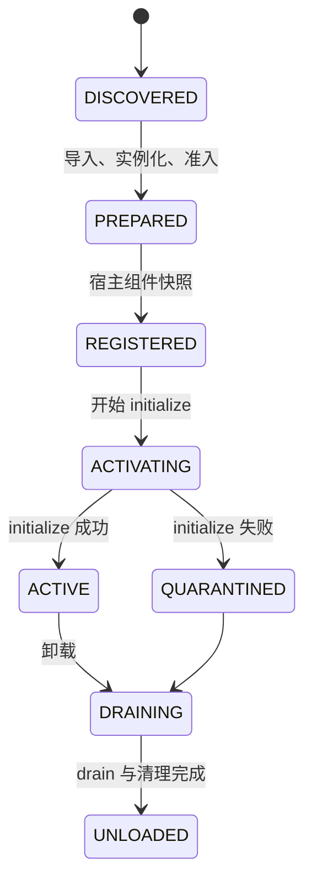

# AstrBot SDK/API 覆盖扩展规格

> 状态：设计已确认，待实施。  
> 上游基线：AstrBot Core 4.29.3。  
> 宿主基线：Neo-MoFox 1.3.0-alpha.0，`onebot_expand>=1.0.10`。  
> 目标：先修正现有运行契约错位，再扩大可导入 SDK 面和可真实执行能力；任何没有宿主等价实现的路径继续明确失败。

## 1. 决策摘要

本轮采用“契约对齐优先”的扩展顺序：

1. 修复生命周期、事件上下文、LLM 实体和工具调用来源绑定；
2. 以 AstrBot 4.29.3 的公开导出建立版本化 SDK 导入矩阵；
3. 对能映射到 Neo-MoFox 公开 API 的能力补齐真实执行；
4. 对只能满足导入、不能满足行为的类型提供可实例化数据模型，但在执行边界明确拒绝；
5. 仍无法无损表达的能力保持拒绝，不使用空对象、固定 `True`、全局最近消息或静默降级。

本规格是现有 [DESIGN.md](../DESIGN.md) 的增量设计。若两者冲突，以本规格中明确标为“替换”的条目为准；完成实施和验收后再回写主设计文档。

## 2. 当前基线与已确认偏差

| 位置 | 当前行为 | 目标行为 |
| --- | --- | --- |
| `AstrPluginUnit.activate()` / `register_task()` | `initialize()` 执行时状态仍为 `REGISTERED`，而任务注册只允许 `ACTIVE` | 增加 `ACTIVATING`，允许初始化期间登记受管任务；初始化失败时取消本阶段创建的任务 |
| `_run_simple_hooks()` | `after_message_sent` 处理器无参数调用 | 从宿主事件参数构造真实 `AstrMessageEvent` 并按官方签名调用 |
| `_run_llm_request_hooks()` / `_run_llm_response_hooks()` | 将 `event=None` 传给钩子 | 仅使用当前调用链或可验证 stream 映射得到的真实事件；无法解析事件时不伪造 |
| `ProviderRequest` | 以宿主内部 `payloads/tools/stream/meta_data` 为主模型，缺少 4.29.3 的多模态、工具结果和会话字段 | 以 AstrBot 4.29.3 的完整公开字段为规范，并把宿主数据放在桥适配层 |
| `CompatLLMResponse` | 主要暴露 `content/tool_calls`，且把宿主 `reasoning_parts` 当作 Astr 公共字段 | 规范暴露 `completion_text`、`result_chain`、`tools_call_*`、`reasoning_content` 和 `reasoning_signature`，保留经过测试的兼容别名 |
| `_latest_event()` | 从整个单元取最后一条消息作为工具来源 | 工具调用必须绑定当前 host `stream_id`；缺少来源时失败，不跨会话猜测 |
| `AstrMessageEvent.should_call_llm()` | 标志可写但宿主从不读取 | 不再伪装支持；在宿主出现独立 LLM 门控契约前，设置 `False` 明确报不支持 |
| SDK `install()` | 约 40 个模块别名，缺少若干 4.29.3 公开路径 | 由版本化模块表安装全部已分类路径，并用导入测试防漂移 |

`stop_event()` 不属于上述缺陷：当前路径会经 `event.is_stopped()` 聚合为宿主 `EventDecision.STOP`。本轮只补充其测试，不改变该语义。

## 3. 支持等级

所有 SDK 符号和方法必须被归入以下一种等级：

| 等级 | 含义 |
| --- | --- |
| E：执行支持 | 导入、构造和运行均有真实宿主映射及行为测试 |
| D：数据支持 | 可导入、构造、读取和序列化；一旦进入宿主执行边界会明确验证或拒绝 |
| I：导入兼容 | 仅保证第三方插件可完成导入/类型检查；调用时抛带能力名的兼容错误 |
| R：准入拒绝 | 声明或使用表明插件依赖不可表达语义，单元在准入期拒绝 |

不得把 I 或 D 写成 README 中的“功能已支持”。

## 4. 生命周期与并发契约

### 4.1 状态机替换



规则：

- `Context.register_task(coro, desc=None)` 在 `ACTIVATING` 和 `ACTIVE` 可用；
- `REGISTERED`、`DRAINING`、`UNLOADED` 调用任务注册均失败；
- `initialize()` 失败时，先隔离单元，再取消该单元在 `ACTIVATING` 期间登记的任务；
- `desc` 进入 `TaskManager` 的名称/元数据，但不得改变任务所有权；
- 所有任务继续通过 `TaskManager` 创建，禁止裸 `asyncio.create_task()`。

### 4.2 调用上下文

桥增加单元级 `ContextVar` 调用上下文，至少保存：

```text
unit_slug, stream_id, message_id, event, invocation_kind
```

消息处理、工具、Web API、LLM 请求和钩子进入时设置，退出时必须恢复 token。此上下文只用于当前异步调用链，不作为跨请求全局缓存。

桥生成的 `BaseTool.execute()` 必须先调用实例公开的 `get_current_stream_id()`，再把结果作为桥私有参数传给单元执行器；该参数不得出现在工具 JSON Schema 中。来源解析顺序固定为：

1. 当前 `BaseTool.get_current_stream_id()` 返回的、由宿主统一 `exec_llm_usable()` 绑定的 `stream_id`；
2. 当前 `ContextVar` 中同单元、同一异步调用链的 `stream_id`；
3. 否则抛 `MissingToolSourceError`。

桥只在 `self.messages[stream_id]` 存在对应来源快照时构造事件；流存在但消息快照不存在同样失败。当前宿主旧 `ToolUse.execute_tool()` 虽接收 `Message`，但没有调用 `_bind_runtime_context()`，且工作区内没有生产调用点：它不属于本轮支持的执行路径。若以后恢复该路径，必须先在宿主执行器中绑定上下文并增加契约测试，桥不得自行从参数、缓存或“最新消息”猜来源。

删除“取单元最新消息”的回退路径，避免多群并发时把回复、发送目标或权限判断路由到错误会话。

## 5. 事件与钩子契约

### 5.1 消息事件结果

单元 `dispatch()` 改为返回结构化结果，而不是单一布尔值：

```text
AstrDispatchOutcome(
    stopped: bool,
    handled: bool,
)
```

桥只把 `stopped=True` 映射为 `EventDecision.STOP`。`handled` 用于日志与测试，不改变 EventBus 键集合。

AstrBot 的 `should_call_llm(False)` 与 Neo-MoFox 的 `EventDecision.STOP` 不是同义操作。当前宿主没有“继续其他事件处理器但跳过 Chatter/LLM”的公开字段，因此：

- 不传参数或设置为 `True` 时返回 `True`；
- 设置为 `False` 抛 `UnsupportedAstrCapabilityError`；
- 删除未被宿主消费的 `_should_call_llm` 可变状态；
- 后续只有在宿主增加独立 LLM 门控 API 后，才升级为 E 级支持。

### 5.2 `after_message_sent`

宿主 `AFTER_MESSAGE_SENT` 参数中存在可验证的出站 `Message` 时：

1. 按所属 stream 构造只读 `AstrMessageEvent`；
2. 调用 `after_message_sent(event)`；
3. 不允许钩子回写 EventBus 参数；
4. 缺少 `Message` 时跳过该次钩子并记录稳定错误码 `ASTR_HOOK_EVENT_MISSING`，不能调用无参数处理器伪装成功。

### 5.3 LLM 钩子

事件解析顺序：

1. 当前 Astr 调用链的 `ContextVar.event`；
2. `meta_data` 中可验证的 `stream_id` 对应的单元消息快照；
3. 无法解析时，本次不调用要求 `event` 的 Astr 钩子并记录原因。

请求和响应适配器必须保持宿主 EventBus 输入键集合完全一致，仅可回写宿主本来允许修改的字段。

## 6. LLM 公共实体对齐

### 6.1 `ProviderRequest`

4.29.3 兼容对象以以下公共字段为规范：

```text
prompt
session_id
image_urls
audio_urls
extra_user_content_parts
func_tool
contexts
system_prompt
conversation
tool_calls_result
model
```

桥内部需要的 `payloads`、`tools`、`stream`、`meta_data` 放入私有适配状态，并可提供经过测试的兼容属性，但不得取代公共字段。映射要求：

- `prompt` 来自最后一个可表达的用户文本；
- `system_prompt` 从 system role payload 聚合；
- `contexts` 保留其余角色消息；
- `image_urls`、`audio_urls` 和 `extra_user_content_parts` 保留可验证的多模态内容，不重复塞入 `contexts`；
- `func_tool` 由宿主工具定义构造，`tool_calls_result` 保留上一轮真实工具结果；
- `session_id` 优先使用当前 `stream_id`；
- `conversation` 只接受真实可构造的 Astr 对象或 `None`，不得用普通字典冒充；
- `model` 使用宿主事件中可验证的模型标识，宿主未提供时为 `None`；
- 无法无损表达的 payload 不得静默丢弃。

钩子修改公共字段后，桥重新生成 `payloads` 和 `tools`；重建失败时保留原请求并报告 `InvalidProviderRequestMutationError`。

### 6.2 `LLMResponse`

规范字段为：

```text
role
result_chain
completion_text
tools_call_name
tools_call_args
tools_call_ids
tools_call_extra_content
reasoning_content
reasoning_signature
is_chunk
id
usage
raw_completion
```

桥可保留 `content` 和 `tool_calls` 只读/可写别名，前提是双向修改行为有测试且不会制造两份不一致状态。回写宿主时：

- `result_chain` / `completion_text -> params["message"]`；
- 工具名称、参数和 ID 按索引校验后重建 `ToolCall`；
- `reasoning_content` 原样回写；`reasoning_signature` 仅在宿主存在同义公开字段时回写；
- 宿主专有的 `reasoning_parts` 只保存在桥私有适配状态，不作为 Astr 4.29.3 公共字段；
- `raw_completion`、`usage` 和 `tools_call_extra_content` 只有在宿主提供同义数据时暴露，否则使用诚实的 `None` / 空值；
- 长度不一致或参数非对象时拒绝该次修改。

## 7. SDK 导入面扩展

### 7.1 版本化模块表

`sdk.install()` 改为从单一声明表创建模块，声明至少包含：

```text
module_path
is_package
exports
support_level
canonical_source
```

首批补齐并纳入导入测试的路径：

- `astrbot.api.util`
- `astrbot.api.web`
- `astrbot.core.star.register`
- `astrbot.core.star.register.star`
- `astrbot.core.star.register.star_handler`
- `astrbot.core.star.filter`
- `astrbot.core.star.filter.command`
- `astrbot.core.star.filter.command_group`
- `astrbot.core.star.filter.custom_filter`
- `astrbot.core.star.filter.event_message_type`
- `astrbot.core.star.filter.permission`
- `astrbot.core.star.filter.platform_adapter_type`
- `astrbot.core.star.filter.regex`
- `astrbot.core.utils.plugin_kv_store`
- `astrbot.core.provider.entities` 与保留的历史拼写别名 `astrbot.core.provider.entites`
- `astrbot.core.provider.modalities`
- `astrbot.core.message.components`
- `astrbot.core.message.message_event_result`

已有别名继续保留，但每个别名必须指向同一 canonical 类对象，不能复制出破坏 `isinstance()` 的平行类型。
4.29.3 不存在 `astrbot.core.star.register.filter`；兼容表不得创建上游不存在的路径来掩盖错误导入。

### 7.2 顶层与工具导出

首批新增导出分类：

| 符号/路径 | 等级 | 行为 |
| --- | --- | --- |
| `StarTools.get_data_dir()` | E | 映射到单元隔离且持久化的数据目录；不依赖调用栈猜插件名 |
| `StarTools.send_message()`、工具启停 | E | 复用已有完整消息链发送和当前单元工具表；未知工具明确失败 |
| `StarTools.register_llm_tool()` / `unregister_llm_tool()` | 条件 E | 仅组件快照前登记，运行期只允许启停既有工具，不改变宿主组件集合 |
| `StarTools.create_message()` / `create_event()` | I | 可导入；宿主没有等价的 Astr 平台事件提交语义，调用明确失败 |
| `PluginKVStoreMixin` 及 `Star.put/get/delete_kv_data` | E | 映射到宿主 `storage_api`，按单元 slug 隔离 |
| `astrbot.api.util` 会话等待器 | I | 保持官方导入名；未建立可取消、可卸载的等价会话等待语义前明确失败 |
| `astrbot.api.web` 请求/响应数据类型 | D/E | 数据包装可构造；仅经桥隔离 Router 注册的请求路径可执行 |
| `ComponentType` | D | 与 4.29.3 枚举值一致，可导入和比较 |
| `AtAll` | D，条件 E | 可构造；仅 OneBot profile 且适配器验收通过时转为全体 `at` 段 |
| `Json` | D/I | 可保存原始 JSON；当前通用出站链无无损映射时明确失败 |
| `Unknown` | D/I | 保留入站未知段，不允许未经登记直接出站 |
| 其余 4.29.3 公开组件 | 逐项分类 | 由消息段契约测试决定 E、D/I 或 R |

### 7.3 KV 存储

KV 键空间固定为：

```text
compat_astr/{slug}/kv
```

要求：

- 值必须可由宿主 JSON 存储层序列化；
- `get_kv_data(key, default)` 不得跨单元读取；
- 写入使用原子存储入口；
- 删除不存在键返回与 4.29.3 一致的可观察结果；
- 卸载不删除持久数据，除非用户显式请求。

## 8. OneBot 与消息组件覆盖

现有 `Plain`、`At`、`Reply`、`Image`、`Record`、`Video`、`File` 映射继续作为 E 级基线。本轮新增：

- `AtAll`：仅在 `onebot_expand`/Adapter 的真实出站测试通过后标为 E；
- `Json`：若 `MessageService` 和目标 Adapter 都能保留 OneBot `json` 段，则仅对 OneBot profile 开启；否则保持 D/I；
- 未知入站段：构造 `Unknown` 并保留类型和深拷贝数据；
- 未知出站段：始终失败，除非被版本化段映射表显式登记；
- 所有新增组件都必须覆盖 canonical 类与已登记旧 SDK 类的 `isinstance()` 兼容。

不得把 `Json`、`Unknown`、`Node` 或 `Face` 转成文本占位。

## 9. 仍明确拒绝的能力

本轮不把以下能力升级为可执行：

- 任意 AstrBot 平台实例/平台注册；
- 自定义 Provider 注册、STT/TTS/embedding Provider 注入；
- conversation/persona/knowledge/cron 管理器的完整 AstrBot 行为；
- `tool_loop_agent()`，除非后续能以宿主公开 Agent 执行器保留逐步工具语义；
- HTML 渲染、文本转图片；
- Dashboard 全局路由和未隔离 Web API；
- `should_call_llm(False)`；
- 无当前 stream 的工具调用；
- 运行期新增宿主 Tool 组件。

导入面可以为其中部分能力提供 I 级符号，但调用必须包含能力名、单元 slug 和稳定错误码。

## 10. 实施切片

### A1：契约修复

涉及：`plugin.py`、`sdk/astr_message_event.py`、`sdk/provider.py`、`sdk/star.py`。

- 加入 `ACTIVATING`；
- 修复初始化期任务注册和失败清理；
- 结构化 `AstrDispatchOutcome`；
- 对 `should_call_llm(False)` 改为明确失败；
- 工具来源绑定当前 stream；
- 钩子传递真实事件；
- 对齐 Provider 请求/响应对象。

### A2：SDK 模块与类型矩阵

涉及：`sdk/__init__.py`、`sdk/message_components.py`、新增的 util/web/register/KV 兼容模块。

- 建立版本化模块表；
- 增加 4.29.3 import fixture；
- 实现 `StarTools`、KV、组件数据模型；
- 为全部导出标注 E/D/I/R。

### A3：执行能力扩展

- KV 存储端到端；
- `AtAll`、条件 `Json` OneBot 传输；
- LLM 钩子修改回写；
- `after_message_sent(event)`；
- 多 stream 并发工具路由。

### A4：清理与发布

- 删除 `_latest_event()` 回退；
- 删除未被读取的假状态；
- 更新 `manifest.json`、README、主 `DESIGN.md`；
- 生成能力矩阵和拒绝列表；
- 用真实 `PluginManager`、`EventBus` 和受控 OneBot 协议端回归。

## 11. 验收测试

| 编号 | 场景 | 断言 |
| --- | --- | --- |
| A201 | `initialize()` 调用 `register_task(coro, desc)` | 任务在 `ACTIVATING` 成功登记；成功后随单元存活 |
| A202 | `initialize()` 登记任务后抛错 | 单元隔离，任务被取消且无残留 |
| A203 | 两个群经 `exec_llm_usable()` 并发触发同一 Tool | 每个 Tool 实例从 `get_current_stream_id()` 取得对应 stream；无全局最后消息串线 |
| A204 | 未绑定 runtime context 的直接 Tool 调用 / 旧 `ToolUse` 路径 | 抛 `MissingToolSourceError`，不选任意历史消息 |
| A205 | `stop_event()` | 桥返回 `EventDecision.STOP` |
| A206 | `should_call_llm(False)` | 抛明确不支持错误，不再静默保存无效标志 |
| A207 | `after_message_sent` | 处理器收到真实出站事件；缺事件时不调用 |
| A208 | LLM 请求钩子 | 文本、多模态、工具、工具结果、会话和模型字段正确，修改可重建 payloads/tools |
| A209 | LLM 响应钩子 | completion/result_chain、reasoning signature、工具调用和宿主私有 reasoning parts 不串义 |
| A210 | 4.29.3 import fixture | 目标深层路径全部可导入且 canonical 类型身份一致 |
| A211 | KV 隔离 | 同键不同 slug 不串读，重载后数据仍在 |
| A212 | `AtAll` | OneBot 验收通过时发送全体 at；非 OneBot 明确失败 |
| A213 | `Unknown` 入站/出站 | 入站数据保留，未经登记出站失败 |
| A214 | 真实宿主加载 | `PluginManager.load_plugin_from_manifest()` 完成加载、执行和卸载 |

## 12. 退出标准

只有同时满足以下条件，README 才可声明本轮能力已支持：

1. A201 至 A214 全部通过；
2. `ruff`、目标测试和真实宿主加载无新增错误；
3. 4.29.3 公开导出清单中每个符号均被分类为 E、D、I 或 R；
4. 不存在无来源工具回退、无参数钩子调用、`event=None` 调用或未读取的行为标志；
5. OneBot 新增段只在真实 Adapter 验收通过后标为 E；
6. 主 `DESIGN.md`、README 与代码中的版本和能力矩阵一致。

